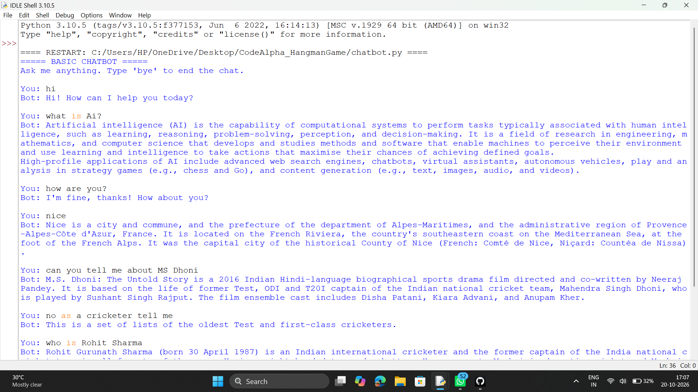
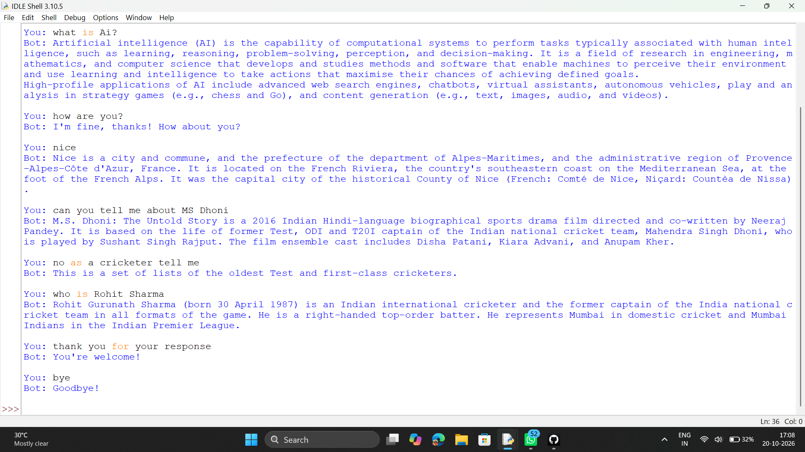

<div align="center">


### 💬 A rule-based chatbot that talks back and answers your questions.

</div>

---

## 📌 About the Project

This project is **Task 4: Basic Chatbot** of the **CodeAlpha Python Programming Internship**.

It is a **rule-based chatbot** built in Python. The user types a message and the bot replies:

- 🗣️ **Predefined rules** handle greetings, small talk, help, time, date and jokes.
- 🌐 **General questions** (like *who is Albert Einstein* or *what is Python*) are answered with a short summary from **Wikipedia**.

The chat continues in a loop until the user types **bye**.

---

## ✨ Features

| | Feature |
|---|---|
| 💬 | Takes **user input** and replies with predefined responses |
| 🌐 | Answers general questions using a **Wikipedia lookup** (needs internet) |
| 🔁 | Runs in a **loop** until the user says `bye` |
| 🔡 | Case-insensitive: `Hello`, `HELLO` and `hello` all work |
| 🧠 | Understands keywords inside full sentences, not only exact words |
| 🕒 | Tells the current **time** and **date** |
| 😄 | Tells random **programming jokes** |
| ⌨️ | Handles empty input without crashing |
| 🛡️ | Shows a friendly message if no answer is found or internet is off |

---

## 🗨️ What the Bot Understands

| You say | Bot replies |
|---|---|
| `hello` / `hi` / `hey` | Hi! How can I help you today? |
| `how are you` | I'm fine, thanks! How about you? |
| `tell me about you` / `who are you` | Introduces itself |
| `help` / `i want help` | Shows what you can ask |
| `what is the time` | Shows the current time |
| `what is the date` | Shows today's date |
| `tell me a joke` | Tells a random joke |
| `thanks` | You're welcome! |
| `who is Albert Einstein` / `what is Python` | Short answer from Wikipedia |
| `bye` | Goodbye! (ends the chat) |

---

## 🛠️ Concepts Used

| Concept | Where it is used |
|---|---|
| `if` - `elif` - `else` | Choosing the right reply |
| Functions | `get_response()`, `search_wikipedia()` and `main()` |
| `while` loop, `break`, `continue` | Keeping the chat running |
| `input()` / `print()` | Talking to the user |
| String methods | `lower()`, `strip()`, `split()` |
| `urllib` + `json` | Fetching and reading the Wikipedia answer |
| `random` and `datetime` | Jokes, time and date |
| Exception handling (`try` / `except`) | Handling no internet or no result |

---

## 🚀 How to Run

1. Install **Python 3** on your system.
2. Download this repository (**Code → Download ZIP**) and extract it.
3. Open `chatbot.py` in **IDLE** (or any Python editor) and press **F5** to run it.
4. Start chatting. Type `bye` to exit.

> 🌐 An internet connection is needed only for general questions answered from Wikipedia. No extra libraries need to be installed.

---

## 💻 Sample Chat

```text
===== BASIC CHATBOT =====
Ask me anything. Type 'bye' to end the chat.

You: hello
Bot: Hi! How can I help you today?

You: how are you
Bot: I'm fine, thanks! How about you?

You: tell me about you
Bot: I am a simple chatbot created with Python for the CodeAlpha internship. Ask me anything!

You: who is Albert Einstein
Bot: (short summary from Wikipedia)

You: bye
Bot: Goodbye!
```

---

## 📸 Output Screenshots

<div align="center">

### Output 1


<br/><br/>

### Output 2


</div>

---

## 📁 Project Structure

```text
CodeAlpha_BasicChatbot/
├── chatbot.py       # main program
├── output1.png      # screenshot of output 1
├── output2.png      # screenshot of output 2
└── README.md        # project documentation
```

---

## 👨‍💻 Author

**Arijit**
Python Programming Intern @ **CodeAlpha**

---

<div align="center">

⭐ **If you like this project, give it a star!** ⭐


</div>
